<div align="center">


# NEXORA

**Move every task from idea to done.**

A full-stack task manager with a FastAPI + PostgreSQL backend and a fast, dependency-free web dashboard:<br>
kanban board, calendar, reports, time tracking, goals, team chat and per-user privacy built in.

[](https://www.python.org/downloads/release/python-3110/)
[](https://fastapi.tiangolo.com/)
[](https://www.postgresql.org/)
[](https://github.com/psf/black)
[](https://pycqa.github.io/isort/)
[](https://github.com/astral-sh/ruff)
[](https://github.com/microsoft/pyright/)
[](https://github.com/Troy2727/NEXORA/actions/workflows/ci.yml)

[Features](#features) · [Screenshots](#screenshots) · [Quick start](#quick-start) · [Architecture](#architecture) · [API](#api-reference) · [Development](#development)

<br>

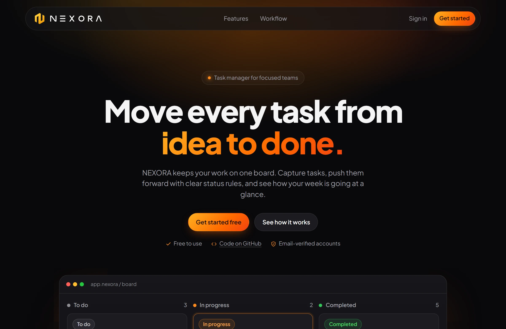

</div>

---

## Features

| | |
|---|---|
| **Kanban board** | To do → In progress → Completed with enforced status rules, search, due dates and overdue highlighting. |
| **Overview dashboard** | Today's focus, progress, 7-day activity chart with week-over-week change, status donut, recent activity and what's up next. |
| **Calendar** | Week view with hour grid and a live "now" line, mini month calendar, *Next up* list with tick-to-complete. |
| **Reports** | Key numbers, tasks created per week, status breakdown, overdue list and **CSV export** (formula-injection safe). |
| **Time & goals** | Focus timer per task with daily/weekly totals, weekly completion goal and daily focus goal. |
| **Team & messages** | Create a team, invite people by email, roles (owner/member), and a team chat with unread badges. |
| **Accounts** | Email-verified sign-up, profile photo upload, name and password changes, account deletion, start-page preference. |
| **Privacy by default** | Every task belongs to its owner, other users get `404` for tasks that aren't theirs, and team data is members-only. |
| **Polished UI** | Dark, responsive design that works on phones, keyboard shortcuts (`N`, `/`), SVG icons and accessible contrast. |

## Screenshots

**Overview**: today's focus, progress, activity, status breakdown and what's next

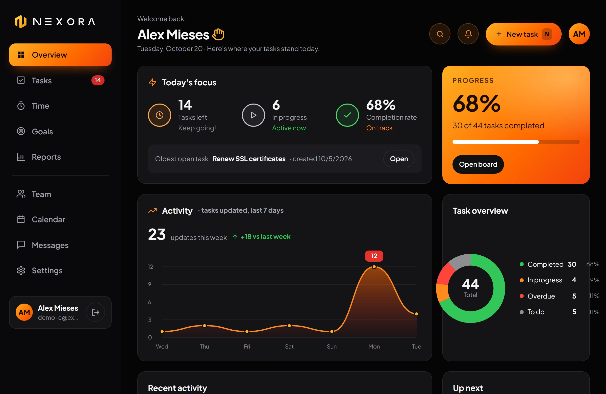

**Board**: tasks move through clear status rules, with due dates and overdue highlighting

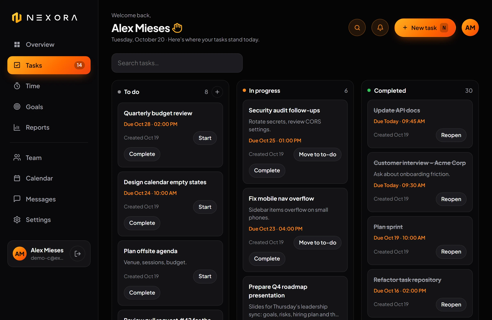

**Calendar**: due dates on a week grid, with a mini calendar and a Next up list

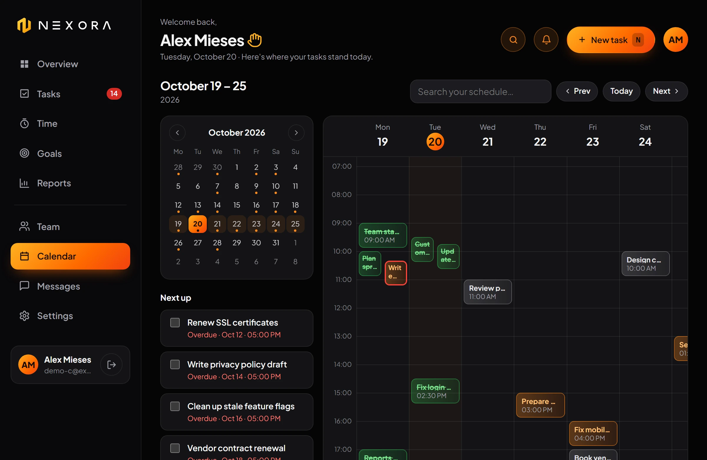

**Team**: members, roles, invites and an avatar group

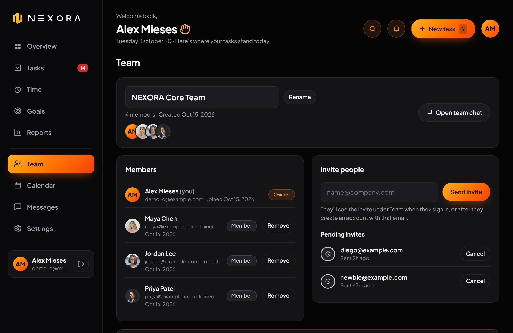

**Messages**: team chat with unread badges

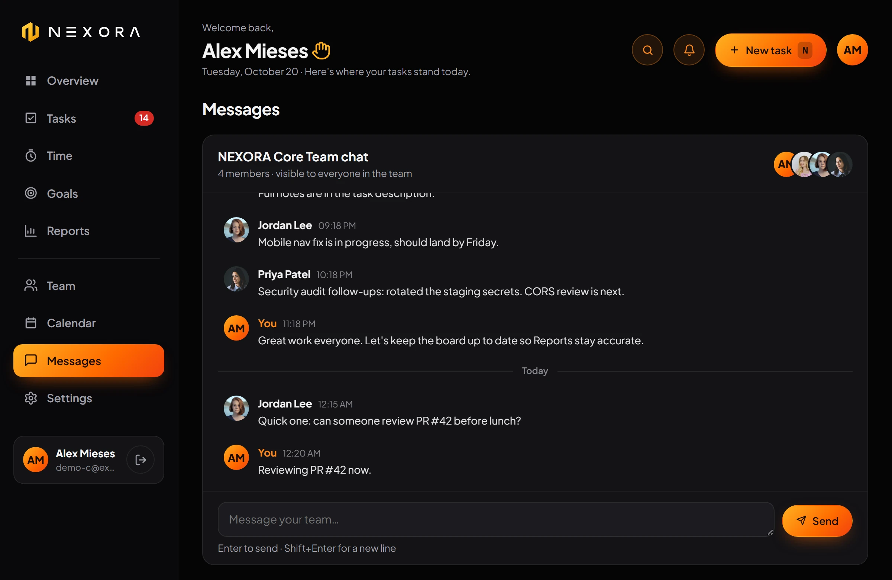

**Reports**: live numbers, tasks per week and CSV export

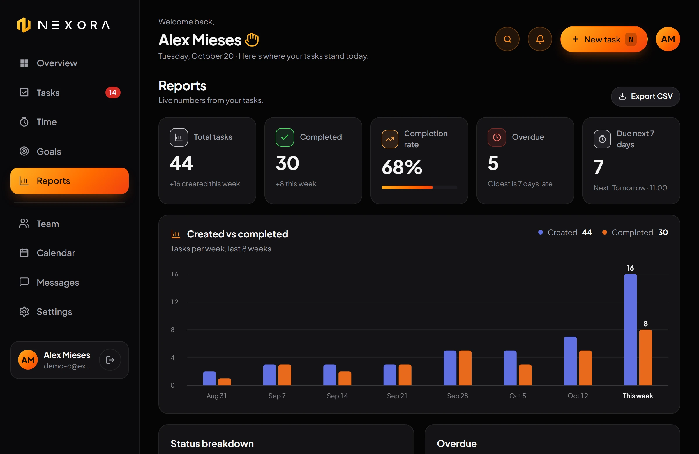

**On phones**

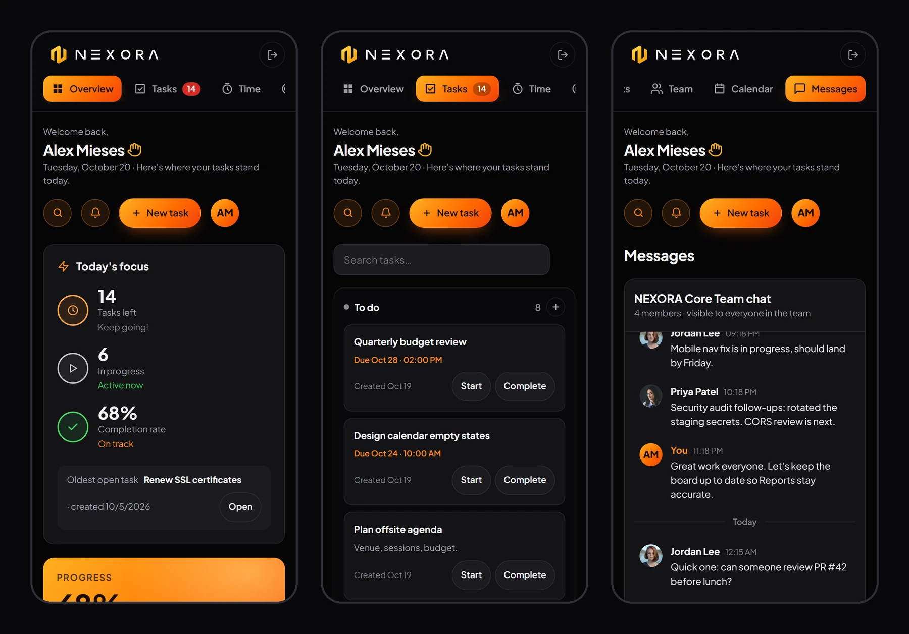

<details>
<summary><b>More screens: Settings, Time, Goals, Sign in</b></summary>
<br>

**Settings**: profile, password, preferences and account

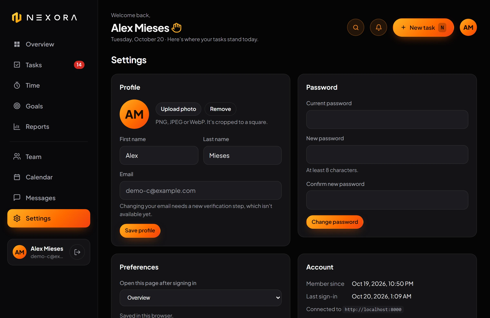

**Time**: focus timer and totals

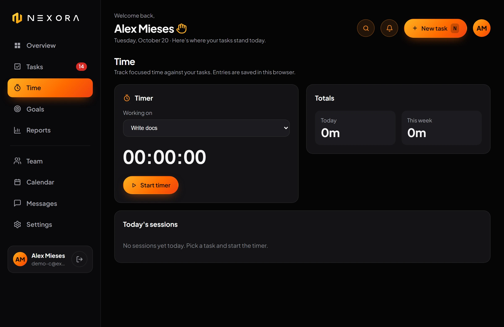

**Goals**: weekly and daily targets

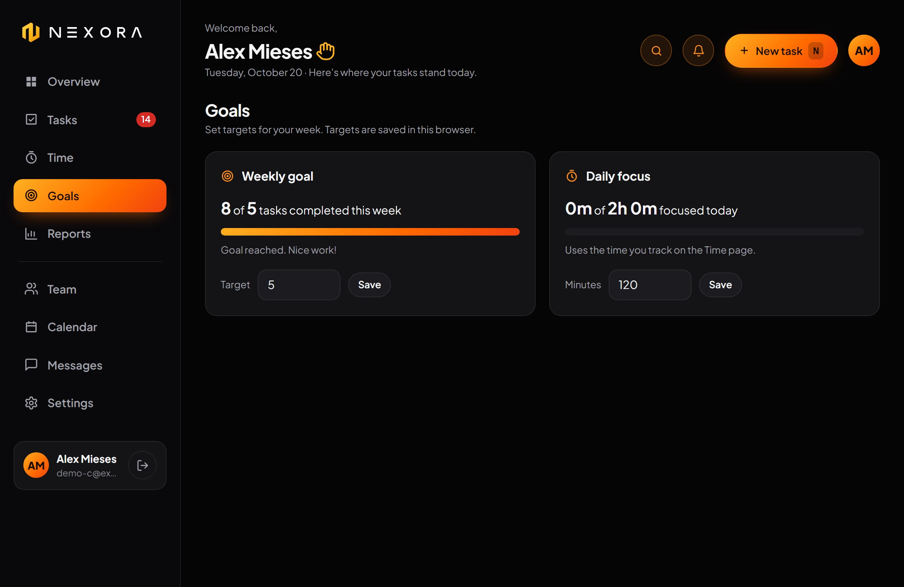

**Sign in**

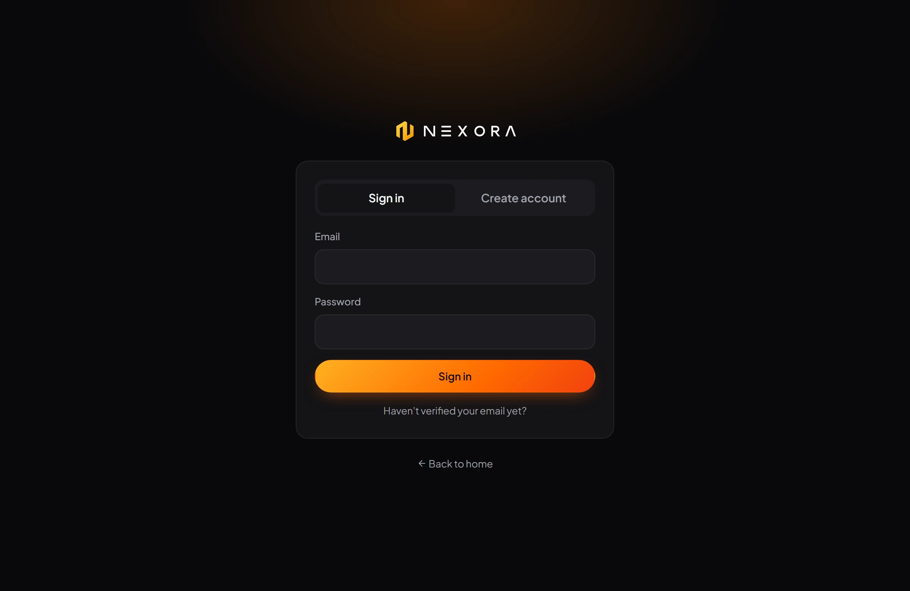

</details>

## Quick start

**Requirements:** Docker and Docker Compose (for the API), and Python 3 (any version) to serve the web app.

```bash
# 1. Configure the API
cp .env.example .env          # then edit the values; change AUTH_SECRET_KEY before deploying

# 2. Start the API, PostgreSQL, Redis and MailCatcher (migrations run automatically)
docker compose up --build

# 3. Serve the web app (no build step needed)
python -m http.server 5173 --directory web
```

| Service | URL |
|---|---|
| Web app | http://localhost:5173 |
| API docs (Swagger UI) | http://localhost:8000/docs |
| Test inbox (MailCatcher) | http://localhost:1080 |

Create an account at **Get started**, open the test inbox to read your 6-digit verification code, and you're in.

> The web app talks to `http://localhost:8000` by default. To point it at another API, run
> `localStorage.setItem("nexora_api", "https://your-api")` in the browser console.

## Deploy

| Part | Where | How |
|---|---|---|
| Web app | Vercel: **https://nexora-five-dun.vercel.app** | `vercel deploy --prod` from `web/` (static, no build) |
| API | Vercel: **https://nexora-api-smoky.vercel.app** ([docs](https://nexora-api-smoky.vercel.app/docs)) | `vercel deploy --prod` from the repo root (FastAPI preset, `requirements.txt`) |
| PostgreSQL + Redis | Neon and Upstash, connected to the API project from the Vercel Marketplace | `vercel integration add neon` / `vercel integration add upstash/upstash-kv` |

The API reads Neon's `PGHOST_UNPOOLED`, `PGUSER`, `PGPASSWORD`, `PGDATABASE` and Upstash's `REDIS_URL`
directly. Migrations don't run on deploy; after adding one, run
`vercel env run -e production -- python -m alembic upgrade head` from the repo root. Set `AUTH_SECRET_KEY`
and, for verification emails, `SMTP_HOST`, `SMTP_PORT` (465), `SMTP_SSL` (true), `SMTP_USERNAME` and
`SMTP_PASSWORD` with `vercel env add`.

## Architecture


<p align="center"><sub>Click the diagram to see it full size.</sub></p>

<details>
<summary>Editable Mermaid version</summary>

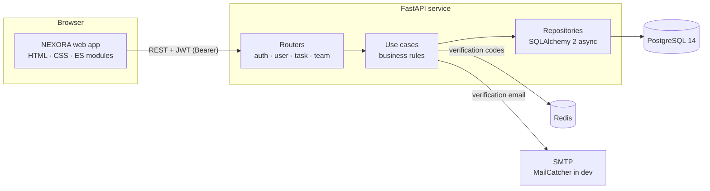

</details>

The backend is layered: **routers** handle HTTP and validation (Pydantic), **use cases** hold the rules
(ownership, permissions, status transitions), and **repositories** talk to the database. Alembic manages
the schema. The frontend is a static site with no build step: one ES module per screen, an SVG icon sprite,
and a small API client.

### Data model


<p align="center"><sub>Click the diagram to see it full size.</sub></p>

<details>
<summary>Editable Mermaid version</summary>

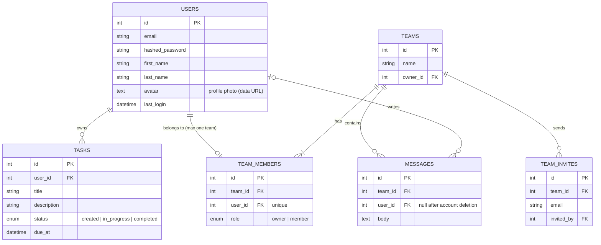

</details>

The animated diagrams are HyperFrames compositions in `docs/diagrams/compositions/`; `docs/diagrams/index.html` lists the commands that render them to `docs/diagrams/renders/`.

### Task lifecycle


<p align="center"><sub>Click the diagram to see it full size.</sub></p>

<details>
<summary>Editable Mermaid version</summary>

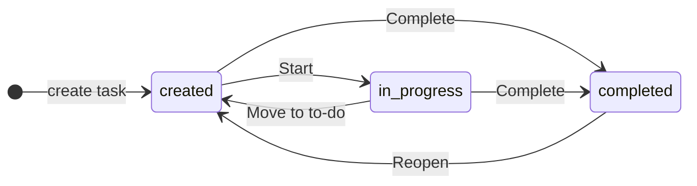

</details>

Transitions are enforced by the API (`PATCH /task/transitions/{id}/{status}`); anything else returns `400`.

### Sign-up and verification


<p align="center"><sub>Click the diagram to see it full size.</sub></p>

<details>
<summary>Editable Mermaid version</summary>

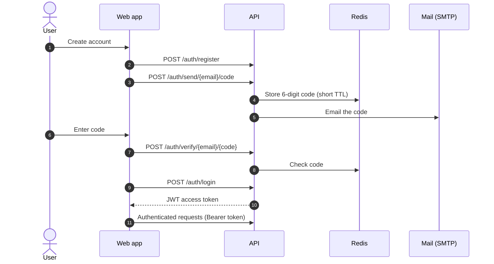

</details>

## Tech stack

| Layer | Technology |
|---|---|
| API | FastAPI 0.115, Pydantic 2, Uvicorn/Gunicorn |
| Database | PostgreSQL 14, SQLAlchemy 2 (async, asyncpg), Alembic |
| Auth | JWT (python-jose), bcrypt password hashing (passlib), email verification via Redis + SMTP |
| Web app | Vanilla HTML, CSS and JavaScript ES modules, inline SVG charts, SVG icon sprite |
| Quality | pytest + pytest-asyncio, black, isort, ruff, pyright, GitHub Actions CI |
| Runtime | Docker, Docker Compose |

## Configuration

Settings are read from environment variables (or `.env`). Defaults are for local development only.

| Variable | Default | Description |
|---|---|---|
| `DB_HOST` · `DB_PORT` | `localhost` · `5432` | PostgreSQL address |
| `DB_LOGIN` · `DB_PASSWORD` · `DB_NAME` | `postgres` · `postgres` · `auth` | PostgreSQL credentials and database |
| `REDIS_HOST` · `REDIS_PORT` · `REDIS_DB` | `redis` · `6379` · `0` | Redis for verification codes |
| `SMTP_HOST` · `SMTP_PORT` | `mailcatcher` · `1025` | Mail server for verification emails |
| `SMTP_SSL` · `SMTP_USERNAME` · `SMTP_PASSWORD` | `false` · `noreply@example.com` · empty | SMTP security and login |
| `AUTH_SECRET_KEY` | `secret` | **JWT signing key, change this in every real deployment** |
| `AUTH_ALGORITHM` | `HS256` | JWT algorithm |
| `AUTH_ACCESS_TOKEN_EXPIRE_MINUTES` | `30` | Session length |
| `AUTH_VERIFY_CODE_TTL` | `60` | Seconds a verification code stays valid |

## API reference

Interactive docs live at **`/docs`**. All endpoints except sign-up and login need `Authorization: Bearer <token>`.

<details open>
<summary><b>Auth</b></summary>

| Method | Path | Description |
|---|---|---|
| `POST` | `/auth/register` | Create an account |
| `POST` | `/auth/send/{email}/code` | Email a verification code |
| `POST` | `/auth/verify/{email}/{code}` | Verify the email address |
| `POST` | `/auth/login` | Sign in and get a JWT |

</details>

<details>
<summary><b>User</b></summary>

| Method | Path | Description |
|---|---|---|
| `GET` | `/user/me` | Current account |
| `PATCH` | `/user/me` | Change first/last name |
| `PUT` | `/user/me/password` | Change password (needs the current one) |
| `DELETE` | `/user/me` | Delete the account and all its tasks (needs the password) |
| `PUT` · `DELETE` | `/user/me/avatar` | Upload or remove the profile photo (PNG/JPEG/WebP, max 256 KB, content-checked) |

</details>

<details>
<summary><b>Tasks</b></summary>

| Method | Path | Description |
|---|---|---|
| `POST` | `/task` | Create a task (optional `due_at`) |
| `GET` | `/task/list` | Your tasks |
| `GET` · `PATCH` · `DELETE` | `/task/{id}` | Read, edit (send `due_at: null` to clear) or delete one of your tasks |
| `GET` | `/task/transitions/{id}` | Allowed next statuses |
| `PATCH` | `/task/transitions/{id}/{status}` | Move a task to a new status |

</details>

<details>
<summary><b>Team &amp; messages</b></summary>

| Method | Path | Description |
|---|---|---|
| `GET` · `POST` · `PATCH` · `DELETE` | `/team` | Your team: view, create, rename, delete (owner) |
| `POST` | `/team/invites` | Invite an email address (owner) |
| `DELETE` | `/team/invites/{id}` | Cancel an invite (owner) |
| `GET` | `/team/invites/mine` | Invites sent to you |
| `POST` | `/team/invites/{id}/accept` · `/decline` | Answer an invite |
| `DELETE` | `/team/members/{user_id}` | Remove a member (owner) |
| `POST` | `/team/leave` | Leave your team (members) |
| `GET` · `POST` | `/team/messages` | Read (`?after_id=` for new ones) or post to the team chat |

</details>

## Project structure

```text
NEXORA/
├── api/
│   ├── routers/          # HTTP endpoints: auth, user, task, team
│   ├── schemas/          # Pydantic request/response models and validation
│   └── dependencies/     # DB session, current user, use-case factories
├── usecases/             # Business rules: auth, tasks, users, teams
├── db/
│   ├── models/           # SQLAlchemy models
│   ├── repositories/     # Data access
│   └── alembic/          # Migrations
├── enums/  exceptions/  settings/  utils/
├── tests/                # API tests (pytest, in-memory SQLite)
├── web/                  # Frontend (no build step)
│   ├── index.html        # Landing page
│   ├── auth.html         # Sign in / sign up / verify
│   ├── app.html          # Dashboard
│   ├── js/               # One ES module per screen + API client
│   ├── css/              # Base, landing, app, calendar, pages, team
│   └── assets/           # Logo, wordmark, SVG icon sprite
├── docs/screenshots/     # Images used in this README
├── docker-compose.yml  Dockerfile  entrypoint.sh
└── pyproject.toml
```

## Development

```bash
poetry install --with dev,test   # install dependencies
pre-commit install               # format and lint on every commit

poetry run pytest -v             # run the test suite
poetry run black --check . && poetry run isort --check-only .
poetry run ruff check . && poetry run pyright .
```

The same checks run in [GitHub Actions](.github/workflows/ci.yml) on every push and pull request to `master`.
Tests cover authentication, task ownership (users can never see or change each other's tasks), due dates,
profile photos, account settings and every team permission rule.

## Security

- **Ownership checks everywhere:** tasks are scoped to their owner; requests for someone else's task return `404`, so they don't reveal that it exists.
- **Team permissions:** only members can read team data and chat; only the owner can invite, remove, rename or delete.
- **Passwords:** hashed with bcrypt; changing the password or deleting the account requires the current password.
- **Uploads:** profile photos are limited to PNG/JPEG/WebP, checked by their actual bytes (not just the name), and capped at 256 KB; SVG is rejected.
- **Output safety:** all user content is escaped in the web app, and CSV exports neutralise spreadsheet formulas.

## Roadmap

- [ ] Shared team tasks and assigning tasks to teammates
- [ ] Changing your email with re-verification
- [ ] Notifications (the bell in the header)
- [ ] Real-time chat over WebSockets (currently refreshes every 5 seconds)
- [ ] Storing time entries and goals on the server (currently saved in the browser)

## Author

Built by **Alex Mieses** ([@Troy2727](https://github.com/Troy2727)).

Released under the [MIT License](LICENSE).
